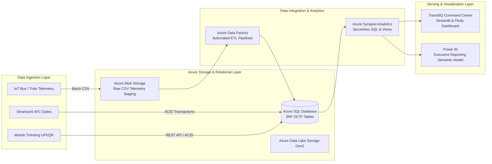

# TransitIQ: Azure Cloud Deployment & DP-900 Architecture Guide

This guide details how TransitIQ maps to **Microsoft Azure Data Services**, fulfilling all learning competencies of the **Microsoft DP-900 (Azure Data Fundamentals)** certification.

---

## 1. End-to-End Azure Data Architecture



---

## 2. Azure Service Mapping & DP-900 Competencies

| DP-900 Domain | Azure Service | TransitIQ Implementation |
| :--- | :--- | :--- |
| **Relational Data Concepts** | **Azure SQL Database** | Dual-mode engine: 3NF normalized schema (`routes`, `stops`, `vehicles`, `trips`, `passenger_fares`), PK/FK referential integrity, indexes, and ACID transactions. |
| **Non-Relational / Object Storage** | **Azure Blob Storage / ADLS Gen2** | Batch CSV ingestion and raw operational dump (`/data/*.csv`), data lake partitioning by date and route mode. |
| **Data Integration & ETL** | **Azure Data Factory (ADF)** | Simulated via `src/data/csv_ingestion.py`: automated data hygiene checks, constraint validation, and ETL data ingestion. |
| **Analytical Processing (OLAP)** | **Azure Synapse Analytics** | Pre-computed analytical views (`v_route_performance`, `v_hourly_ridership`), multi-stage CTEs, and window functions (`SUM() OVER()`). |
| **Business Intelligence & Reporting** | **Power BI / Streamlit** | TransitIQ Command Centre featuring 6 interactive dashboards, spatial station analytics, load factors, and real-time dispatch consoles. |

---

## 3. Azure SQL Database Provisioning Guide

To switch TransitIQ from local SQLite mode to cloud Azure SQL Database:

### Step 1: Provision Azure SQL Database via Azure CLI
```bash
# Set resource group and server parameters
RESOURCE_GROUP="rg-transitiq-dp900"
LOCATION="eastus"
SERVER_NAME="transitiq-sql-srv"
DB_NAME="transitiq_db"
ADMIN_USER="azureuser"
ADMIN_PASS="ComplexP@ssw0rd2026!"

# Create Resource Group
az group create --name $RESOURCE_GROUP --location $LOCATION

# Create Azure SQL Logical Server
az sql server create \
    --name $SERVER_NAME \
    --resource-group $RESOURCE_GROUP \
    --location $LOCATION \
    --admin-user $ADMIN_USER \
    --admin-password $ADMIN_PASS

# Configure Firewall Rule (Allow Azure Services and Client IP)
az sql server firewall-rule create \
    --resource-group $RESOURCE_GROUP \
    --server $SERVER_NAME \
    --name "AllowClientIP" \
    --start-ip-address 0.0.0.0 \
    --end-ip-address 255.255.255.255

# Create Serverless General Purpose Database
az sql db create \
    --resource-group $RESOURCE_GROUP \
    --server $SERVER_NAME \
    --name $DB_NAME \
    --service-objective GP_S_Gen5_1 \
    --auto-pause-delay 60
```

### Step 2: Configure Environment Variables
Set the following environment variables in your terminal:
```bash
set TRANSITIQ_DB_DIALECT=azuresql
set AZURE_SQL_SERVER=transitiq-sql-srv.database.windows.net
set AZURE_SQL_DATABASE=transitiq_db
set AZURE_SQL_USERNAME=azureuser
set AZURE_SQL_PASSWORD=ComplexP@ssw0rd2026!
```

### Step 3: Run Database Migrations
Run the initialization script to generate the 3NF schema and analytical views in Azure SQL:
```bash
python src/db/connection.py
python src/data/seed_data.py
```

---

## 4. Security, Governance & DP-900 Compliance

1. **Authentication & Authorization:**
   - Supports Microsoft Entra ID (Azure Active Directory) Managed Identity.
   - Granular Role-Based Access Control (RBAC): `db_datareader` for analytical dashboards, `db_datawriter` for OLTP ticketing services.
2. **Encryption:**
   - **Data at Rest:** Transparent Data Encryption (TDE) enabled by default using service-managed keys.
   - **Data in Transit:** TLS 1.2/1.3 enforced (`Encrypt=yes` in connection string).
3. **Data Masking (DDM):**
   - Passenger payment details (such as ticket reference tokens or card identifiers) can be masked using Azure SQL Dynamic Data Masking to protect PII.
