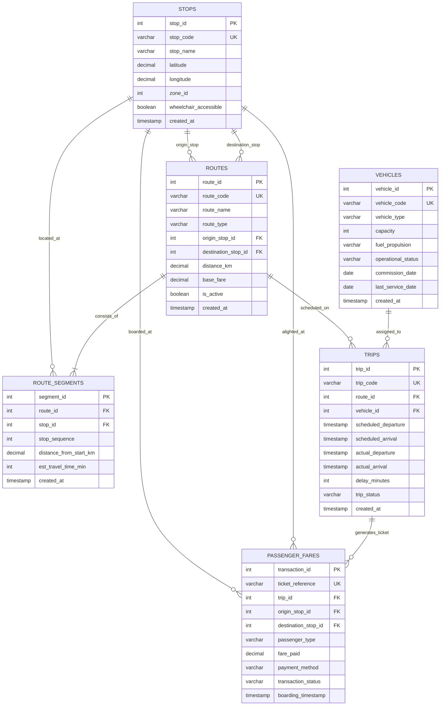

# TransitIQ Entity-Relationship Architecture & Normalization Analysis

## 1. Entity-Relationship Diagram (ERD)

The diagram below visualizes the 3NF relational data model of **TransitIQ**, showing table structures, primary keys (`PK`), foreign keys (`FK`), and cardinalities.

---

## 2. Normalization Proofs (1NF, 2NF, 3NF)

A central objective of Microsoft DP-900 is mastering relational modeling and normalization to eliminate insertion, update, and deletion anomalies while ensuring data consistency.

### 2.1 First Normal Form (1NF) Proof
A relation is in **1NF** if and only if:
1. Every attribute contains only atomic (indivisible) scalar values.
2. There are no repeating groups or multi-valued arrays.
3. Each record possesses a unique identifier (Primary Key).

*Verification in TransitIQ:*
- Stop geographic coordinates are decomposed into scalar `latitude` and `longitude` fields rather than a composite text string `(lat, lon)`.
- Fares, routes, and trips contain single values per column.
- Every entity has an explicit integer primary key (`stop_id`, `route_id`, `vehicle_id`, `trip_id`, `transaction_id`).
- **Conclusion: Fully complies with 1NF.**

---

### 2.2 Second Normal Form (2NF) Proof
A relation is in **2NF** if:
1. It is in First Normal Form (1NF).
2. All non-key attributes are fully functionally dependent on the entire primary key (no partial dependencies).

*Verification in TransitIQ:*
- In a naive transit model, stop sequences and route details might be combined into a compound key `(route_id, stop_sequence)`. If station name were stored in that table, station name would depend only on `stop_id`, creating a partial dependency.
- In TransitIQ, the many-to-many relationship between `routes` and `stops` is factored into an independent junction table: `route_segments`.
- In `route_segments`, the surrogate primary key `segment_id` uniquely identifies the segment, and attributes such as `stop_sequence`, `distance_from_start_km`, and `est_travel_time_min` depend on the specific route-stop association.
- All single-key tables (`stops`, `routes`, `vehicles`, `trips`, `passenger_fares`) have single-column primary keys, automatically satisfying 2NF.
- **Conclusion: Fully complies with 2NF.**

---

### 2.3 Third Normal Form (3NF) Proof
A relation is in **3NF** if:
1. It is in Second Normal Form (2NF).
2. There are no transitive functional dependencies ($X \rightarrow Y$ and $Y \rightarrow Z$, where non-key attribute $Z$ depends on non-key attribute $Y$).

*Verification in TransitIQ:*
- **Trip and Route separation:** Storing `route_type`, `distance_km`, or `route_name` inside `trips` would introduce a transitive dependency:
  $$\text{trip\_id} \rightarrow \text{route\_id} \rightarrow \text{distance\_km}$$
  If a route distance changed, multiple trip rows would need updating (Update Anomaly). TransitIQ stores route details strictly in `routes` and references only `route_id` in `trips`.
- **Passenger Fares and Station Details:** Similarly, `passenger_fares` stores only `origin_stop_id` and `destination_stop_id`. Station coordinates and zone information are resolved by joining `stops`, preventing redundancy.
- **Vehicle Fleet Information:** `trips` stores only `vehicle_id`. The vehicle's propulsion type, seating capacity, and commission date are isolated in `vehicles`.
- **Conclusion: Fully complies with 3NF.**

---

## 3. Referential Integrity & Relational Constraints

TransitIQ enforces strict data integrity via SQL DDL constraints:
1. **Primary Keys:** Unique identity across all tables with auto-increment.
2. **Foreign Keys:**
   - `ON DELETE RESTRICT` on core master entities (`stops`, `vehicles`, `routes`) to prevent accidental cascade deletion of operational history.
   - `ON DELETE CASCADE` on `route_segments` when a draft route is removed.
3. **CHECK Constraints:**
   - `distance_km > 0`
   - `base_fare >= 0`
   - `capacity > 0`
   - Restricted enumerations for `route_type`, `vehicle_type`, `operational_status`, `trip_status`, `passenger_type`, and `payment_method`.
4. **UNIQUE Constraints:**
   - Composite unique constraints on `route_segments(route_id, stop_sequence)` ensuring no two stops have duplicate sequence order on the same line.
   - Composite unique constraints on `route_segments(route_id, stop_id)` preventing loop errors.
