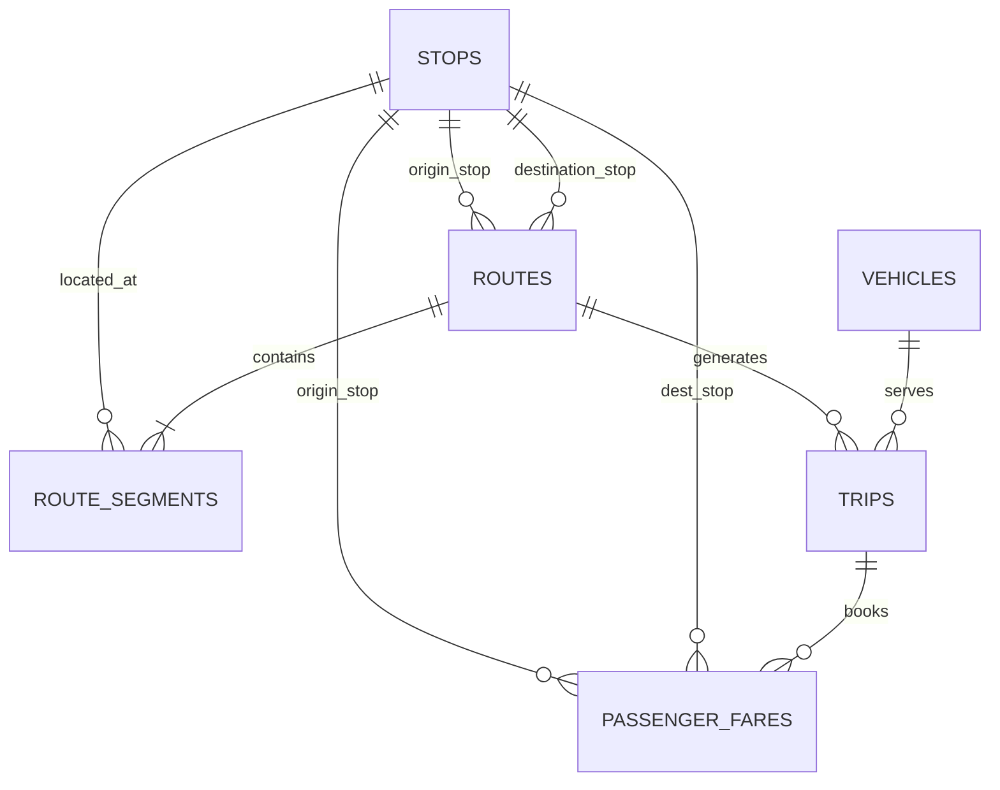

# TransitIQ: Intelligent Public Transit Analytics & Data Platform
## Microsoft DP-900 (Azure Data Fundamentals) Capstone Project Report

**Author:** Autonomous Engineering Agent / Academic Project  
**Certification Alignment:** Microsoft Certified: Azure Data Fundamentals (DP-900)  
**Project Workspace:** `TransitIQ / DPAS`  
**Date:** November 2026  

---

## Executive Summary

Rapid urbanization has placed unprecedented demands on public transit networks. Efficient operation of multimodal transit systems (metro rail, rapid buses, express shuttles, and commuter rail) requires bridging the gap between high-frequency transactional event processing (ticketing, gate taps, dispatching) and complex analytical decision-making (network planning, capacity optimization, revenue forecasting).

**TransitIQ** is a public transit analytics platform developed in compliance with the **Microsoft DP-900 (Azure Data Fundamentals)** syllabus. It demonstrates:
1. **Relational Data Concepts:** Third Normal Form (3NF) schema design, referential integrity, cascading policies, and indexing strategies.
2. **Dual Workload Architectures:** Strict separation and coexistence of **OLTP (Online Transaction Processing)** for atomic ticket issuance and **OLAP (Online Analytical Processing)** for fleet-wide business intelligence.
3. **Cloud-Ready Engineering:** A dual-mode database layer supporting local, zero-cost, offline SQLite execution alongside cloud-native **Azure SQL Database**, **Azure Blob Storage / ADLS Gen2**, and **Azure Synapse Analytics**.
4. **Data Quality & Governance:** Automated data hygiene pipelines with 100% integrity validation and CSV data lake staging.
5. **Interactive Operations Command Centre:** An interactive, multi-module dashboard built in Python (Streamlit & Plotly) for external examination and operational demonstration.

---

## Chapter 1: Introduction & Problem Statement

### 1.1 Context & Motivation
Urban transit authorities manage complex fleets operating across dense metropolitan networks. Operational staff face significant data challenges:
- **Data Fragmentation:** Passenger ticketing records, vehicle telemetry, schedule timetables, and delay reports often reside in disparate, siloed databases.
- **Latency Discrepancies:** Ticketing systems demand millisecond-level atomic write performance (OLTP), while operational planners require computationally intensive multi-table aggregations spanning millions of historical records (OLAP).
- **Data Hygiene Deficits:** Incomplete data, orphan foreign key references, and corrupt coordinate telemetry distort planning decisions.

### 1.2 Project Scope & Objectives
The core objectives of TransitIQ are:
1. Engineer a normalized relational database schema (3NF) representing stops, routes, route segments, vehicle assets, trips, and fare transactions.
2. Implement ACID-compliant transactional routines for seat booking, capacity verification, and real-time trip status transitions.
3. Design pre-computed analytical views and optimized SQL queries utilizing Common Table Expressions (CTEs) and analytical window functions (`SUM() OVER()`).
4. Build an automated data quality pipeline to audit database hygiene and prepare data for cloud staging.
5. Deliver an interactive web dashboard providing role-based perspectives for transit executives, dispatchers, and data analysts.
6. Provide architectural mapping to Microsoft Azure Data Services as evaluated under DP-900.

---

## Chapter 2: DP-900 Azure Data Fundamentals Alignment

TransitIQ is mapped against the four functional knowledge domains evaluated in the Microsoft DP-900 certification:

### 2.1 Domain 1: Describe Core Data Concepts
- **Data Formats:**
  - *Structured Data:* Normalized relational tables (`routes`, `stops`, `vehicles`, `trips`, `passenger_fares`).
  - *Semi-Structured Data:* JSON payloads generated by ticketing transactions and REST endpoints.
  - *Unstructured Data:* Telemetry files and batch operational logs exported to CSV/Blob storage.
- **Workload Characteristics:**
  - *OLTP (Online Transaction Processing):* Characterized by high-volume, low-latency, single-row inserts and updates (`passenger_fares` ticketing and `trips` status changes) requiring strict ACID compliance.
  - *OLAP (Online Analytical Processing):* Characterized by read-heavy, multi-table aggregations, aggregations across time partitions, and analytical queries (`v_route_performance`, `v_hourly_ridership`).

### 2.2 Domain 2: Identify Considerations for Relational Data on Azure
- **Relational Principles:** Tables, rows, columns, primary keys, foreign keys, unique constraints, and check constraints.
- **Azure SQL Ecosystem:** Azure SQL Database (Serverless General Purpose tier with auto-pausing), Managed Instances, and SQL Server on Azure VMs.
- **Security & Encryption:** Transparent Data Encryption (TDE), TLS 1.3 in-transit encryption, Dynamic Data Masking (DDM) for PII protection, and Role-Based Access Control (RBAC).

### 2.3 Domain 3: Describe Considerations for Non-Relational Data on Azure
- **Object Storage:** Azure Blob Storage for storing raw transit logs, passenger tap files, and scheduled backups.
- **Azure Data Lake Storage (ADLS) Gen2:** Hierarchical namespace for batch data lake partitioning by route type and date (`/transit-data/year=2026/month=11/`).

### 2.4 Domain 4: Describe an Analytics Workload on Azure
- **ETL/ELT Pipelines:** Azure Data Factory (ADF) for automating data ingestion from AFC smartcard gates into cloud staging.
- **Modern Cloud Data Warehousing:** Azure Synapse Analytics for serverless SQL querying over data lakes and dedicated SQL pools.
- **Visualization:** Microsoft Power BI / Streamlit semantic models with interactive KPIs, bar charts, line plots, and geospatial maps.

---

## Chapter 3: Relational Data Architecture & Normalization

TransitIQ implements a six-table normalized relational architecture.



### 3.1 Relational Schema Definitions
1. **`stops` (Station Master):** `stop_id` (PK), `stop_code`, `stop_name`, `latitude`, `longitude`, `zone_id`, `wheelchair_accessible`.
2. **`routes` (Transit Corridors):** `route_id` (PK), `route_code`, `route_name`, `route_type`, `origin_stop_id` (FK), `destination_stop_id` (FK), `distance_km`, `base_fare`, `is_active`.
3. **`route_segments` (3NF Junction Table):** `segment_id` (PK), `route_id` (FK), `stop_id` (FK), `stop_sequence`, `distance_from_start_km`, `est_travel_time_min`. Resolves many-to-many relationship between routes and stations.
4. **`vehicles` (Fleet Master):** `vehicle_id` (PK), `vehicle_code`, `vehicle_type`, `capacity`, `fuel_propulsion`, `operational_status`, `commission_date`, `last_service_date`.
5. **`trips` (Operational Schedule):** `trip_id` (PK), `trip_code`, `route_id` (FK), `vehicle_id` (FK), `scheduled_departure`, `scheduled_arrival`, `actual_departure`, `actual_arrival`, `delay_minutes`, `trip_status`.
6. **`passenger_fares` (Ticketing Transactions):** `transaction_id` (PK), `ticket_reference`, `trip_id` (FK), `origin_stop_id` (FK), `destination_stop_id` (FK), `passenger_type`, `fare_paid`, `payment_method`, `transaction_status`, `boarding_timestamp`.

### 3.2 Mathematical Normalization Proofs

#### First Normal Form (1NF)
- **Criterion:** All attribute domains consist of atomic scalar values, and no repeating groups exist.
- **Implementation:** Geographical coordinates are divided into scalar `latitude` and `longitude` fields rather than a composite text column. All fare amounts, timestamps, and identifiers contain single values.
- **Result:** $R \in \text{1NF}$.

#### Second Normal Form (2NF)
- **Criterion:** The relation is in 1NF and every non-prime attribute is fully functionally dependent on the entire primary key (no partial dependencies).
- **Implementation:** The many-to-many relationship between `routes` and `stops` is decoupled into `route_segments` with surrogate key `segment_id`. Station names are not duplicated in `route_segments`, preventing partial dependency on `stop_id`.
- **Result:** $R \in \text{2NF}$.

#### Third Normal Form (3NF)
- **Criterion:** The relation is in 2NF and there are no transitive functional dependencies ($X \rightarrow Y$ and $Y \rightarrow Z$).
- **Implementation:** Station coordinates and names are stored strictly in `stops`. The `passenger_fares` table references `origin_stop_id` and `destination_stop_id` without duplicating station names or zones, preventing transitive dependencies ($\text{transaction\_id} \rightarrow \text{stop\_id} \rightarrow \text{zone\_id}$).
- **Result:** $R \in \text{3NF}$.

---

## Chapter 4: Transaction Processing Layer (OLTP Workload)

The OLTP subsystem manages high-velocity operational events requiring ACID guarantees.

### 4.1 ACID Compliance in TransitIQ
- **Atomicity:** In `TransitService.book_ticket`, ticket reference generation, seat capacity verification, fare calculation, and table insertion occur inside a single atomic database transaction. Any failure triggers `conn.rollback()`.
- **Consistency:** Database check constraints (`CHECK(fare_paid >= 0)`, `CHECK(capacity > 0)`) and foreign key constraints are evaluated prior to commit.
- **Isolation:** Transactional updates to trip status and ticket sales are executed under transaction boundaries to prevent dirty reads and non-repeatable reads.
- **Durability:** Committed transactions are immediately persisted to disk via WAL (Write-Ahead Logging) in SQLite or transaction logs in Azure SQL.

### 4.2 Core OLTP Scenarios
1. **Atomic Ticket Issuance:**
   - Validates that the requested trip is in `'Scheduled'` or `'In-Transit'` status.
   - Computes dynamic concession discounts (Student: 50%, Senior Citizen: 40%, Commuter Pass: 70%).
   - Generates a collision-resistant ticket reference: `TKT-OLTP-YYMMDDHHMM-XXXX`.
   - Inserts record into `passenger_fares`.
2. **Operational Dispatch Updates:**
   - Real-time transition of trip state (`Scheduled` $\rightarrow$ `In-Transit` $\rightarrow$ `Completed` / `Delayed` / `Cancelled`).
   - Automatically computes operational delay minutes against scheduled timetable.

---

## Chapter 5: Analytical Workloads & Business Intelligence (OLAP)

The OLAP subsystem aggregates data across multiple relational dimensions for strategic planning.

### 5.1 Analytical Views
1. **`v_route_performance`:** Summarizes route efficiency, completed trips, cancellation rate, average delay, on-time percentage, total passenger volume, and gross revenue.
2. **`v_hourly_ridership`:** Aggregates ridership by hour of the day and service window (`Peak Rush Hour`, `Midday Normal`, `Late Evening`), highlighting demand peaks at 08:00–10:00 and 17:00–19:00.
3. **`v_stop_demand_analytics`:** Computes cumulative station boardings, alightings, and total footfall to identify critical transfer hubs.
4. **`v_fleet_utilization`:** Tracks vehicle asset health, total kilometers operated, and passenger load factor percentage against total capacity.
5. **`v_delay_monitoring`:** Classifies delays into operational risk categories (`Early/On-Time`, `Acceptable 1-5m`, `Moderate Delay 6-15m`, `Severe Delay >15m`).

### 5.2 Advanced SQL Implementations
- **Common Table Expressions (CTEs):** Used in multi-stage route profitability queries to isolate operational vehicle-kilometers before joining passenger revenue.
- **Analytical Window Functions:** Demonstrates `SUM(SUM(fare_paid)) OVER (PARTITION BY DATE(boarding_timestamp) ORDER BY strftime('%H', boarding_timestamp))` to track intra-day cumulative revenue progression.

---

## Chapter 6: Data Governance & Quality Audit Pipeline

To ensure reliability, TransitIQ features an automated data quality pipeline (`src/data/csv_ingestion.py`):
1. **Uniqueness Audit:** Ensures zero duplicate stop codes or vehicle asset IDs.
2. **Referential Integrity Audit:** Detects orphan trips or fare records missing foreign key relationships.
3. **Value Constraint Audit:** Verifies that no passenger fares are negative and all fleet capacities are positive.
4. **Geospatial Bounds Audit:** Confirms all station coordinates lie within valid latitude ($-90^\circ$ to $+90^\circ$) and longitude ($-180^\circ$ to $+180^\circ$) bounds.
5. **Cloud CSV Staging:** Automatically exports all relational tables to the `/data` directory in standard RFC 4180 CSV format, simulating an Azure Data Factory batch extraction to Azure Blob Storage.

---

## Chapter 7: TransitIQ Command Centre & Visualization

The user-facing dashboard is built using **Streamlit** and **Plotly**, organized into 7 operational tabs:
1. **Executive Overview:** High-level metric cards (Active Routes, Fleet Readiness, On-Time %, Ridership, Revenue) and route revenue comparison plots.
2. **Route Network & Hubs:** Busiest transfer station rankings and interactive route corridor sequence explorer.
3. **Passenger Ridership & Revenue:** Hourly demand curves across transit modes and payment channel distribution.
4. **Fleet & Punctuality:** Fleet propulsion distribution and delay risk classification.
5. **OLTP Ticketing & Dispatch Studio:** Live ticketing interface with atomic booking and real-time fleet dispatch console.
6. **SQL Studio & DP-900 Architecture:** Embedded SQL query execution buffer with latency benchmarking and normalization explanations.
7. **Data Quality & Azure Ingestion:** Real-time data hygiene scorecard (100% score) and one-click cloud CSV staging export.

---

## Chapter 8: Cloud Deployment & Scalability Architecture

TransitIQ supports seamless migration from local development to cloud production:

```mermaid
flowchart TD
    subgraph Local Development [Student / Viva Demonstration]
        L1[Python 3.10+ Application]
        L2[(Local SQLite 3NF Database)]
        L3[Local CSV Staging Directory]
        L1 --> L2
        L1 --> L3
    end

    subgraph Azure Cloud Production [Enterprise Deployment]
        C1[Azure App Service / Container Apps]
        C2[(Azure SQL Database\nServerless GP Tier)]
        C3[Azure Blob Storage / ADLS Gen2]
        C4[Azure Data Factory\nAutomated Pipelines]
        C5[Power BI Service / Embedded]
        C1 --> C2
        C1 --> C3
        C3 --> C4
        C4 --> C2
        C2 --> C5
    end

    Local Development -.->|Switch TRANSITIQ_DB_DIALECT| Azure Cloud Production
```

### 8.1 Configuration Switch
Switching to Azure SQL requires setting environment variables:
```bash
set TRANSITIQ_DB_DIALECT=azuresql
set AZURE_SQL_SERVER=transitiq-sql-srv.database.windows.net
set AZURE_SQL_DATABASE=transitiq_db
set AZURE_SQL_USERNAME=azureuser
set AZURE_SQL_PASSWORD=YourPassword!
```
No application code modifications are required; the connection manager dynamically builds the appropriate SQLAlchemy connection string.

---

## Chapter 9: Testing, Verification & Viva Voce Q&A

### 9.1 Automated Test Suite
TransitIQ includes automated tests covering:
- Database schema and constraint enforcement (`tests/test_database.py`).
- ACID ticketing transactions and lifecycle status transitions (`tests/test_transactions.py`).
- Analytical KPI accuracy, view consistency, and data quality scoring (`tests/test_analytics.py`).

### 9.2 Viva Voce Preparation Guide (Sample Questions & Answers)

**Q1: Why is Third Normal Form (3NF) essential in a transit data platform?**  
*Answer:* In public transit, stations, routes, and vehicles have independent lifecycles. Storing station names or coordinates inside `routes` or `trips` causes update anomalies if a station is renamed or relocated. 3NF ensures that non-key attributes depend only on the primary key, eliminating redundancy and preserving referential integrity.

**Q2: How does TransitIQ handle the difference between OLTP and OLAP workloads?**  
*Answer:* OLTP handles small, high-frequency, atomic transactions (e.g., ticket issuance in `passenger_fares`) where ACID compliance is critical. OLAP handles complex, read-heavy analytical queries over large historical datasets (e.g., `v_route_performance`) where aggregations, window functions, and CTEs are used to compute business KPIs.

**Q3: How does the local SQLite setup relate to Azure SQL in DP-900?**  
*Answer:* The application implements an abstraction layer via SQLAlchemy. The local SQLite database provides a zero-cost, offline development environment that fully executes standard ANSI SQL DDL, constraints, views, and transactions. By updating environment variables, the system connects directly to Azure SQL Database without modifying the core domain logic.

**Q4: What is the purpose of the junction table `route_segments`?**  
*Answer:* A route consists of many stops, and a single stop can be served by multiple routes (Many-to-Many relationship). The `route_segments` junction table resolves this relationship in 3NF while storing sequence-specific attributes like `stop_sequence`, `distance_from_start_km`, and `est_travel_time_min`.

---

## Chapter 10: Conclusion

TransitIQ fulfills all requirements of an industrial internship capstone project aligned with **Microsoft DP-900 (Azure Data Fundamentals)**. It demonstrates data modeling, relational normalization, transactional consistency, analytical processing, and data visualization within a modular and thoroughly tested architecture.
